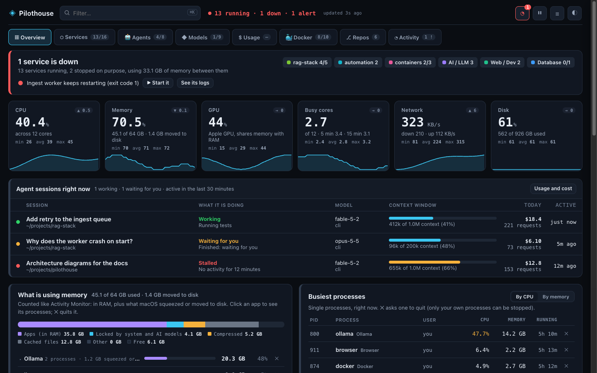
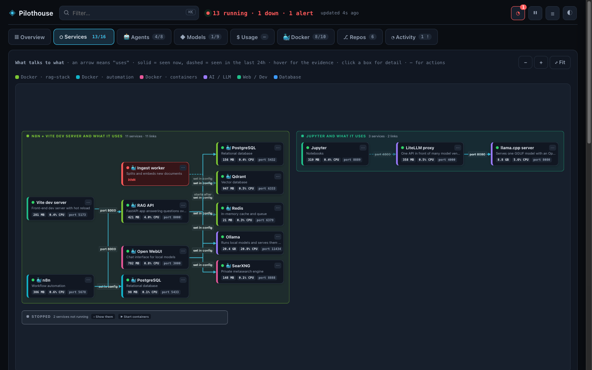
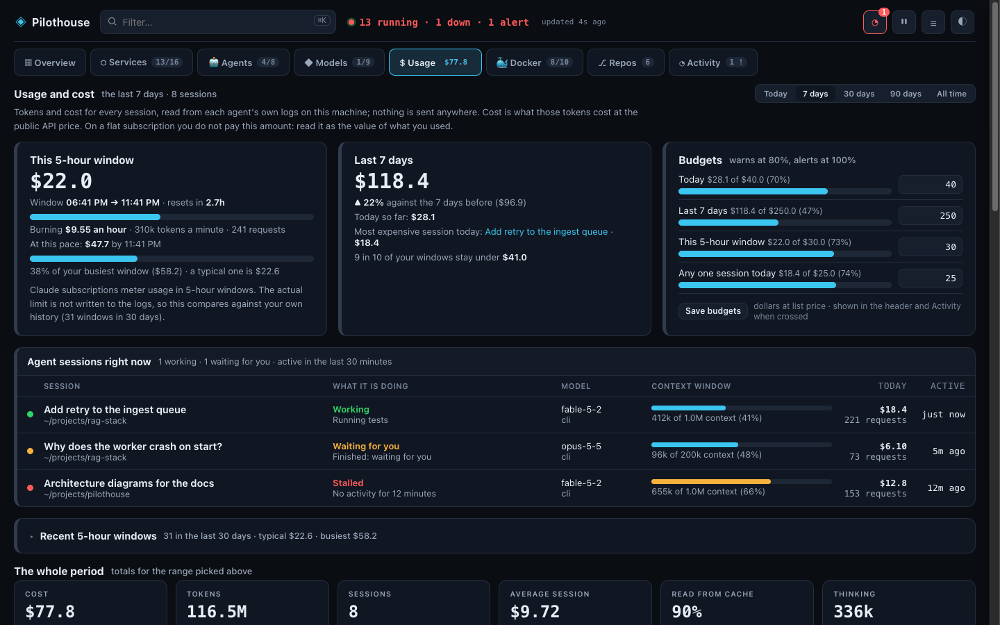
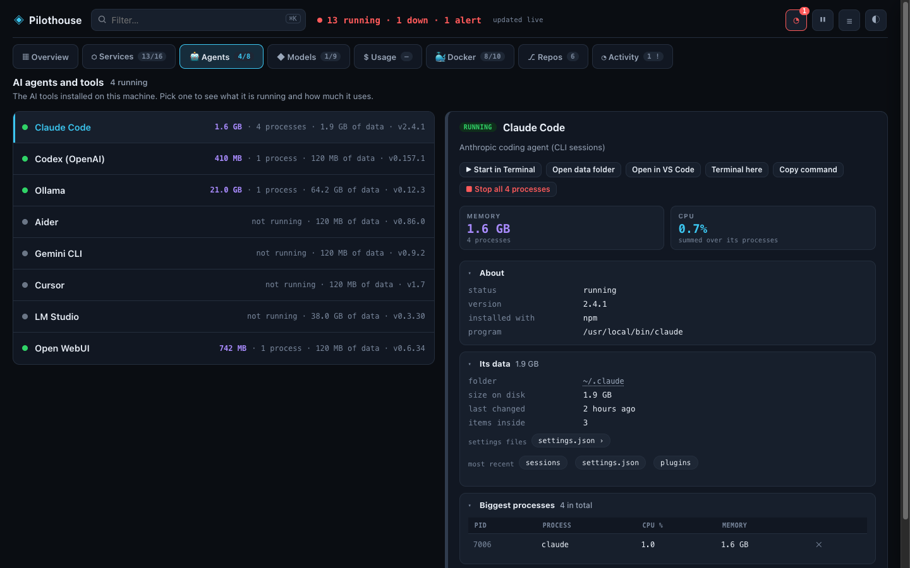
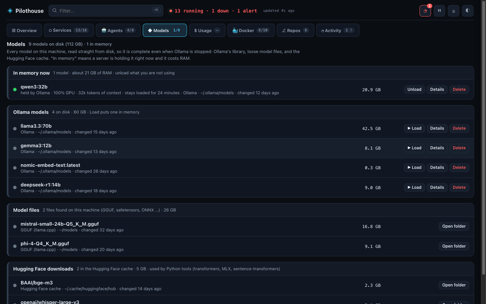
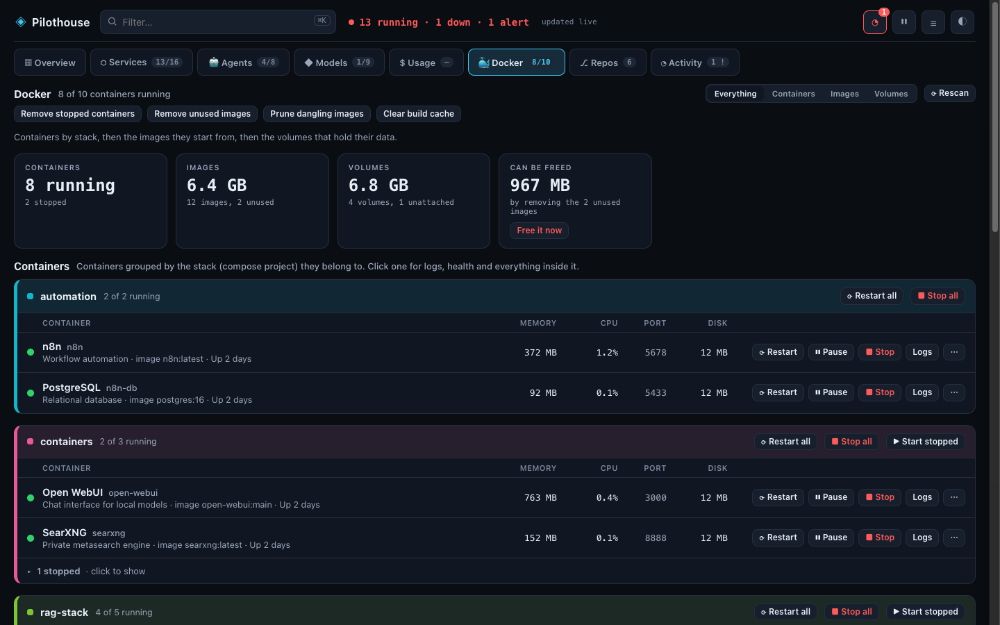
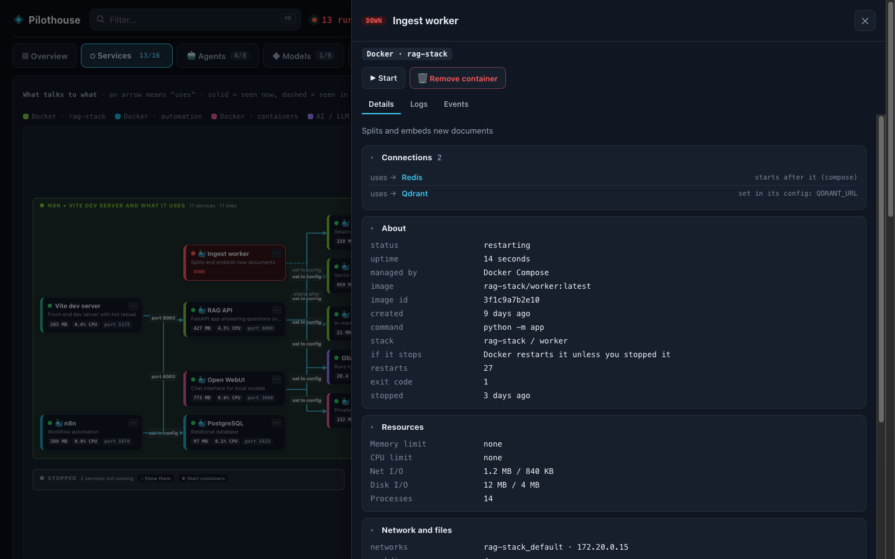
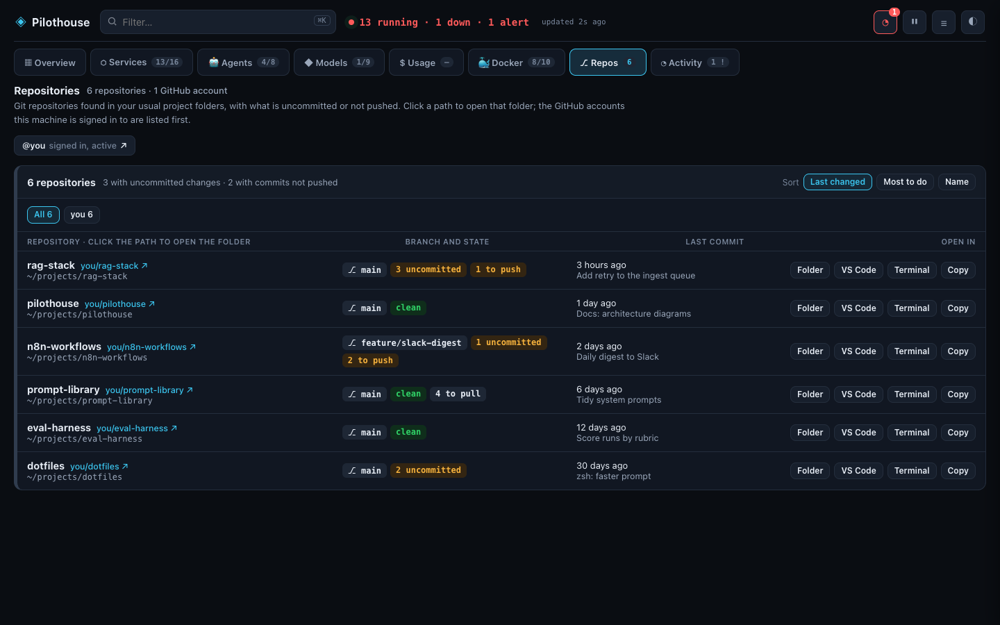
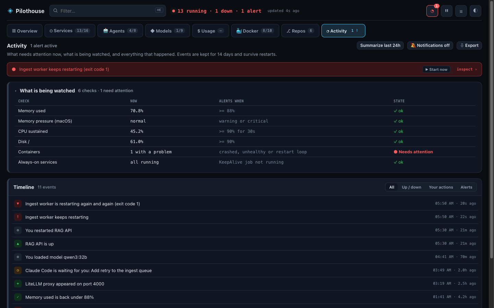
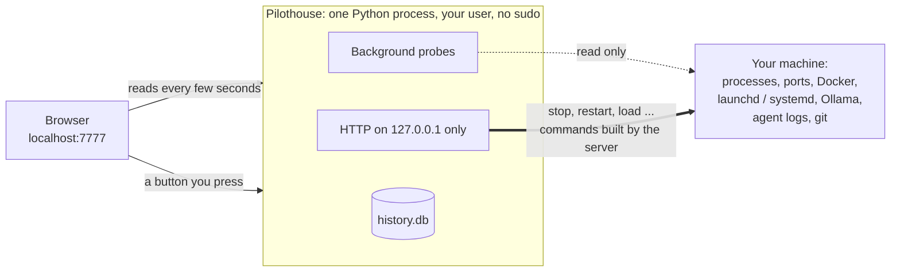

# Pilothouse

One local page to see and steer your AI stack: the services, agents and models
running on your machine, what they use, and what they cost.

Clone it, run it, open it. It discovers whatever is on **your** machine.
No config files, no accounts, no `pip install`, nothing leaves the computer.

[](https://github.com/hamzakoc/pilothouse/actions/workflows/ci.yml)
-brightgreen)




<sub>Screenshots show the built-in sample data (`--demo`), not a real machine.</sub>

## Quick start

```bash
git clone https://github.com/hamzakoc/pilothouse.git
```

```bash
cd pilothouse
```

```bash
python3 server.py --open
```

That is the whole install. The page opens at **http://localhost:7777**, signed in.
(A browser that has never seen it asks once for the access key: press
**Sign in this browser** on that screen.)
On Windows use `py server.py --open`, or double-click `start.bat`
(`start.command` on macOS, `start.sh` on Linux).

Just want to look first? This shows a made-up stack and reads nothing from your
machine:

```bash
python3 server.py --demo --open
```

Something missing? This prints what it can and cannot see here:

```bash
python3 server.py --doctor
```

New here? [Take the tour](docs/TOUR.md): every tab in one screenshot and a few lines.

Requirements: **Python 3.8+** and a browser. Everything else is optional: you get
more when `docker`, `ollama`, `git` or `gh` are installed. Full steps per system,
and how to start it at login: [docs/INSTALL.md](docs/INSTALL.md).

## What you get

| Tab | What it answers |
|---|---|
| **Overview** | Is anything wrong right now? Where is my memory going, app by app? What happened while I was away? |
| **Services** | What is running, on which port, what is it for, what talks to what? Start, stop, restart, remove. |
| **Agents** | Which AI tools are installed and running, how much they use, where their files are. Stop or launch them. |
| **Models** | Every model I have downloaded, which are in memory, on what. Load, unload, delete. |
| **Usage** | Tokens and cost per session, agent, model, project and day. The open 5-hour window, burn rate, budgets. |
| **Docker** | Containers, images, volumes, disk use. One-click control and clean-up. |
| **Repos** | My git repositories with branch, uncommitted changes, ahead/behind. Click to open the folder. |
| **Activity** | The timeline of everything that went up, down or was changed, and the alert rules. |

| | |
|---|---|
| **Services**: what talks to what<br/>[](docs/img/services.png) | **Usage**: tokens and cost<br/>[](docs/img/usage.png) |
| **Agents**: your AI tools<br/>[](docs/img/agents.png) | **Models**: on disk and in memory<br/>[](docs/img/models.png) |
| **Docker**: stacks, images, volumes<br/>[](docs/img/docker.png) | **Detail** of one service<br/>[](docs/img/detail.png) |
| **Repos**<br/>[](docs/img/repos.png) | **Activity**: timeline and alert rules<br/>[](docs/img/activity.png) |

Click a picture to enlarge it. What each tab is for and what to try first:
[docs/TOUR.md](docs/TOUR.md).

All of it is auto-detected:

- **Services** - every Docker container (running or stopped) and every listening host
  port, named with one line of what it is, grouped (AI / LLM, Database, Automation,
  Web / Dev, Infra, Docker · _project_). Each row shows live memory, CPU and a
  memory trend. Running things on top, stopped things folded at the bottom.
- **Control** - Docker: start, stop, restart, pause, resume, kill, remove, or a whole
  compose project at once. Homebrew services: start, stop, restart. launchd agents:
  restart, "stop and keep stopped", start again. systemd user units: restart, stop.
  Any other process of yours: stop or force kill. Destructive actions ask first and
  say what else goes down with them.
- **Map** - what talks to what, drawn left to right. A line exists only with
  evidence, shown on hover: a live TCP connection, a container's configuration
  pointing at another container, or compose `depends_on`. Each connected set of
  services is its own colored section.
- **Where memory goes** - Activity Monitor style breakdown (apps, wired, compressed,
  cached, free) and memory and CPU **per app** with helper processes folded into
  their app. Memory is footprint (resident + compressed + swapped), so a model the
  OS has compressed still shows as the 25 GB it costs you.
- **Service detail** - live CPU and memory charts, what manages it, image, restart
  policy, limits, ports, networks, mounts, child processes, open files, what it
  depends on and what uses it, environment (secrets hidden), logs with filter and
  follow.
- **History that survives the night** - one sample a minute and every event go to a
  small sqlite file (48 hours of metrics, 14 days of events). Charts switch between
  Live, 1h, 6h, 24h and 48h. A "While you were away" strip says what went down,
  which alerts fired and the peaks, with times.
- **Alerts** - memory, macOS memory pressure, sustained CPU, disk, crashed,
  unhealthy or restart-looping containers, always-on services that are not running,
  budgets. In the header, on the Overview and as optional desktop notifications.
- **Docker** - every container with state, CPU, memory, ports; detail down to
  health-check output, processes inside, mounts and limits; images (update, remove
  unused) and volumes (remove unattached); true `docker system df` totals; prune
  dangling, unused, stopped or build cache.
- **Agents** - 40 AI tools recognised (list below): installed, running, version, how
  it was installed, memory, its processes, its data folder and settings files.
- **Models** - Ollama models read from disk (so they show while Ollama is stopped),
  plus `.gguf` and Hugging Face files found in common folders; which are loaded, on
  GPU or CPU, context size, when they unload.
- **Usage and cost** - read from each agent's own records. Input, cache writes
  (5-minute and 1-hour), cache reads, output and thinking are shown separately. A
  session opens to a per-model, per-hour and per-sub-agent breakdown. Forked or
  resumed sessions are counted once. Message text is never stored.
- **Right now** - the open 5-hour usage window (cost so far, burn rate, projected
  total), this week against last, and every session active in the last 30 minutes
  with what it is doing (working, waiting for you, stalled) and how full its context
  window is.
- **Budgets** - per day, per 7 days, per 5-hour window and per session. 80% warns,
  100% alerts.
- **Repos** - git repositories under your common dev folders, with branch, state
  and a link to the remote; plus your `gh` accounts.
- **For scripts** - `GET /api/health`, a Prometheus `GET /metrics`, and the same
  JSON API the page uses.
- Light and dark theme, keyboard shortcuts (`1` to `8` for tabs, `⌘K` palette, `/`
  filter).

## How it works



One process looks at the machine every few seconds, keeps what it finds in memory,
writes a little history to sqlite, and answers the page. The page can only name a
thing (a service, a pid, a model); the server decides what command that means.
The full picture, with diagrams for discovery, the map, actions, states and the
cost pipeline: [docs/ARCHITECTURE.md](docs/ARCHITECTURE.md).

## Operating systems

| | macOS | Linux | Windows |
|---|---|---|---|
| Services, ports, processes, memory, CPU | `ps` + `lsof` | read from `/proc` (no extra tools) | PowerShell + `netstat` (built in) |
| Stop or kill a process | yes | yes | yes (`taskkill`) |
| Restart a managed service | launchd, Homebrew | systemd user units | not yet |
| Docker containers, images, volumes | yes | yes | yes |
| Map of what talks to what | yes | yes | yes |
| Agents, models, repos, usage and cost | yes | yes | yes |
| Open folder, editor, terminal | yes | yes | yes |
| Memory breakdown | apps, wired, compressed, cached | apps, cached, free | used, free |
| Tested by | the author, daily | automated run in a Linux container | automated run in CI only |

CI starts Pilothouse on all three systems on every push, has it discover a small test
server and stops that server through the API. Windows has not been used by a person
yet: treat it as new, and please open an issue with what you see.

## AI tools it recognises

Coding agents: Claude Code, Claude desktop, Codex, Gemini CLI, GitHub Copilot CLI,
Cursor, Windsurf, Zed, opencode, Amp, Aider, Cline, Roo Code, Kilo Code, Continue,
Qwen Code, Crush, Factory Droid, Kiro, Amazon Q CLI, Goose, Open Interpreter,
OpenClaw, Hermes, Paperclip, llm, ChatGPT desktop.
Local runtimes and UIs: Ollama, LM Studio, llama.cpp, MLX LM, vLLM, LocalAI, Jan,
GPT4All, Msty, AnythingLLM, Open WebUI, ComfyUI, text-generation-webui.

Anything else: add four lines to `agents.json` ([how](docs/CONFIGURATION.md#agentsjson-teach-it-an-ai-tool-it-does-not-know)).
A tool that is not in the list still shows up under Services whenever it listens on
a port, with its memory, CPU, logs and a stop button.

**Usage and cost** exists only where a tool keeps readable records: Claude Code
(checked against Claude Code's own per-session cost) and Hermes today; Codex is read
from its documented log format but has not been checked against real sessions. For
any other tool, write one line per request into `~/.pilothouse/usage/<name>.jsonl`
([format](docs/CONFIGURATION.md#usagenamejsonl-usage-of-a-tool-pilothouse-cannot-read)).
Claude models are priced out of the box; a button on the Usage tab downloads a public
price list for other vendors.

## Configuration

None is needed. The options that exist:

```bash
python3 server.py --port 8899 --open
```

```bash
DASH_REPOS=/opt/work DASH_ALERT_MEM=92 python3 server.py
```

| Variable | Default | Purpose |
|---|---|---|
| `DASH_PORT` | `7777` | Port to serve on |
| `DASH_DATA` | `~/.pilothouse` | Where history and your additions live |
| `DASH_TOKEN` | a random key | Your own access key instead of the generated one |
| `DASH_AUTH` | on | `off` removes the access key (only where you trust every program on the machine) |
| `DASH_REPOS` | not set | Extra folders to search for git repositories |
| `DASH_HIDE` | not set | Extra process names to leave out |
| `DASH_ALERT_MEM` / `_DISK` / `_CPU` | `88` / `90` / `90` | Alert thresholds in percent |

Everything else, including your own tools, prices and usage records:
[docs/CONFIGURATION.md](docs/CONFIGURATION.md).

## Safety

- Listens on `127.0.0.1` only. Never uses `sudo`. No telemetry.
- Every read and every action needs an access key that only you can read, so another
  user or a sandboxed program on the same machine cannot use it. Your browser gets
  the key once.
- The browser can only name a service, a pid, an app or a model. The server builds
  every command itself. There is no way to send it a command or a path.
- It only signals processes that belong to **you**, never pid 1, never itself.
- Another website open in your browser cannot read it or press its buttons
  (cross-site requests and DNS rebinding are refused).
- Everything it displays (names, paths, commit subjects, log lines) is treated as
  hostile and escaped. It does not run `git` inside a repository whose own settings
  could start other programs.
- Secrets in environments, command lines and logs are masked before they reach the
  page.
- Bulk clean-up never touches Docker volumes. Removing one image or volume is only
  possible when Docker reports it unused, and it asks first.

What it protects against, what it does not, and how to report a problem:
[SECURITY.md](SECURITY.md).

## Documentation

| | |
|---|---|
| [docs/TOUR.md](docs/TOUR.md) | A walk through every tab, with screenshots |
| [docs/INSTALL.md](docs/INSTALL.md) | Install per system, start at login, update, remove |
| [docs/ARCHITECTURE.md](docs/ARCHITECTURE.md) | How it works, with diagrams |
| [docs/CONFIGURATION.md](docs/CONFIGURATION.md) | Options, your own tools, prices and usage records |
| [docs/API.md](docs/API.md) | The HTTP API, health check and Prometheus metrics |
| [docs/TROUBLESHOOTING.md](docs/TROUBLESHOOTING.md) | When something is missing or looks wrong |
| [SECURITY.md](SECURITY.md) | Security model and reporting |
| [CONTRIBUTING.md](CONTRIBUTING.md) | Rules, checks and recipes for changes |
| [CHANGELOG.md](CHANGELOG.md) | What changed |
| [SPEC.md](SPEC.md) | The behaviour contract the checks enforce |

## Repository layout

```
pilothouse/
├── server.py              start here: python3 server.py
├── start.command          double-click launchers (macOS, Linux, Windows)
├── start.sh
├── start.bat
├── pilothouse/            the program (Python standard library only)
│   ├── app.py             probes, state, actions, HTTP server
│   ├── demo.py            sample data for --demo
│   └── web/index.html     the whole page: HTML, CSS, JS, no build step
├── docs/                  guides, diagrams and screenshots
├── examples/              agents.json, pricing.json, usage records, login items
├── scripts/
│   ├── check.sh           read-only checks against a running instance
│   ├── smoke.py           starts a fresh instance and exercises it (used by CI)
│   └── hostile-data.js    escaping test for the page (paste into the console in --demo)
├── .github/               CI workflow, issue and pull request templates
└── pyproject.toml         optional: pip install . gives a `pilothouse` command
```

## Known limits

- Windows: stopping a program works; restarting Windows services is not wired, the
  owner of a process is not shown, and per-process memory is the working set.
- Linux: system-wide systemd units need root, so only user units get Restart; a
  listening port owned by another user cannot be attributed to a process.
- Nothing is recorded while Pilothouse is not running. Start it at login to cover
  the night.
- Map links between two containers come from their configuration, not from sniffing
  traffic, so a link nobody configured by name does not appear.
- Memory shared between processes is counted in each of them, as in most process
  monitors.
- Cost is tokens at public list price. On a subscription it is the value of the
  usage, not your bill. The 5-hour window edges are worked out from your own
  activity and are approximate.
- The map library is loaded from a CDN; offline, the list view still works.

## Contributing

Small, focused changes are welcome, especially new tools, better names for services
and reports from systems nobody has tried. Start with
[CONTRIBUTING.md](CONTRIBUTING.md).

## License

MIT, see [LICENSE](LICENSE).
