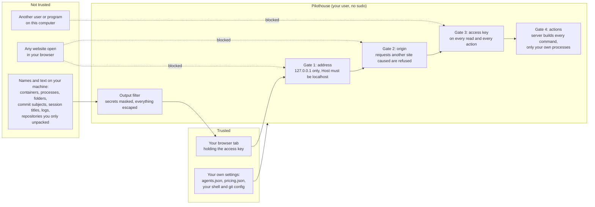

# Security

Pilothouse can stop your processes, remove your containers and delete your models.
This page says what stands between that power and anyone who is not you, what does
not, and how to report a problem.

## Reporting a problem

Please do not open a public issue for a security problem. Use the repository's
**Security > Report a vulnerability** form (GitHub private advisory). Include what
you did, what happened, your operating system and the output of
`python3 server.py --version`. You will get an answer within a week.

## The model in one picture

## What protects you

### 1. It is not on the network

It listens on `127.0.0.1` only. There is no option to listen elsewhere. To use it
from another machine, tunnel: `ssh -L 7777:127.0.0.1:7777 you@host`.

### 2. Other websites cannot reach it

A page on another site can make your browser send requests to `localhost`. Four
checks stop that from doing anything:

- **Host check.** The `Host` header must be `localhost`, `127.0.0.1` or `[::1]` with
  the right port. This defeats DNS rebinding.
- **Origin check.** Browsers label every request with where it came from
  (`Sec-Fetch-Site`, `Origin`). A request another site caused is refused before any
  work starts, including plain `GET`s such as an `` pointing at the API.
- **Custom header on changes.** Every `POST` needs `X-Dash: 1`, which a cross-site
  form cannot send.
- **No CORS headers, no framing.** Other origins cannot read answers
  (`Cross-Origin-Resource-Policy: same-origin`), and the page cannot be put in a
  frame (`frame-ancestors 'none'`), so its buttons cannot be clickjacked.

### 3. Other users and programs on the computer need the key

Anything running on the machine can connect to `127.0.0.1`: another user, or a
sandboxed program that cannot read your files but can open local connections (an AI
agent, for example). So every read and every action needs an **access key**.

- A random key is created on first start and kept in `~/.pilothouse/token`,
  readable only by you (mode 0600). `DASH_TOKEN` sets your own.
- `python3 server.py --open` hands it to your browser in the address fragment
  (`http://localhost:7777/#t=...`). Browsers never send a fragment to a server and
  never put it in a `Referer`. The page stores it for this address only and removes
  it from the address bar. A cookie is deliberately not used: cookies for
  `localhost` are sent to every program serving on any localhost port.
- The key is printed only to a terminal, never into a log file.
  `python3 server.py --link` prints the address again.
- `GET /api/health` (counts and a version) answers without the key so scripts and
  uptime checks can use it. Everything else, including `/metrics`, does not.
- The "Sign in this browser" button (`POST /api/pair`) also works without the key. It
  returns no key: it makes Pilothouse open its signed-in address in the default
  browser of the user it runs as, at most once every 10 seconds. The worst another
  user of the machine can do with it is make a tab appear in your browser.
- `DASH_AUTH=off` turns the key off. Do that only on a machine where you trust
  every user and every program.

The key does not protect you from a program running as you with access to your
files: it can read the key file, as it can read your SSH keys.

### 4. The browser names things, the server decides commands

A request carries a service id, a pid, an app name or a model name. Never a
command, a path or a flag.

- Ids are looked up in what Pilothouse itself discovered. An unknown id is refused.
- Each service has a list of allowed actions; anything else is refused.
- Commands are built as argument lists, not shell strings. The four shell strings in
  the code are constants.
- Processes: only ones owned by you, never pid 1, never Pilothouse or its parents.
  The process list is re-read at the moment of the signal.
- Docker clean-up: bulk prune never touches volumes. One image or volume can be
  removed only when Docker reports it unused.
- "Open folder / editor / terminal" opens only locations Pilothouse discovered. On
  macOS a folder that is an app bundle is shown in Finder, not launched. On Windows
  a path with characters the command prompt would execute is refused.
- It never uses `sudo`.

### 5. What it shows is treated as hostile

Container names, process names, folder names, commit subjects, git remotes, model
file names, session titles and log lines can all be chosen by someone else (a
repository you cloned, an image you pulled).

- Every such value is escaped before it enters the page, for text, attributes and
  inline handlers (`esc`, `jq`, `url` in `index.html`).
- `scripts/hostile-data.js` appends a breakout payload to every string the API
  returns and walks every tab, drawer and menu. A clean run reports no injected
  element and no escaped handler. Run it after any change to the page.
- A Content-Security-Policy stops the page from loading or sending anything
  anywhere except this server and the one CDN the map library comes from. Those two
  script files are pinned by hash (SRI): a changed file is refused by the browser.

### 6. Repositories you did not write

Running `git` inside a folder runs whatever that folder's `.git/config` says
(`core.fsmonitor`, `filter.*.clean`, `gpg.program`, hooks). A hostile repository you
only unpacked could therefore run code the moment a tool looks at it.

- Branch, origin and last commit are read from plain files in `.git`. Nothing runs.
- `git` itself (for uncommitted, ahead and behind) runs only when the repository's
  own config contains nothing but harmless keys from a fixed allowlist, and even
  then with hooks, fsmonitor and signature checks switched off on the command line.
- Other repositories show "status not read". That is this rule working.

### 7. Secrets

- Container environment: variables whose name looks secret (`KEY`, `TOKEN`, `PASS`,
  `SECRET`, `AUTH`, `DSN`, `WEBHOOK`, ...) are never sent to the page; the count of
  hidden ones is shown.
- Command lines, health checks, git remotes and log lines pass through a filter that
  masks credentials in URLs (`://user:pass@`), values after `--api-key`,
  `--password`, `--token` and similar, `password=...` pairs, bearer tokens and
  well-known key shapes.
- The usage reader keeps token counts, model ids, timestamps, session titles and
  folders. It never stores message text.
- The data folder is readable only by you (0700, database 0600).

This filter is a safety net, not a guarantee: a secret in an unusual shape inside a
log line will be shown as written. Do not share screenshots of the Logs tab without
reading them. For screenshots in bug reports, use `--demo`.

## What it does not protect against

| Case | Why |
|---|---|
| A program running as you with access to your files | It can read the key file and everything Pilothouse can. This is true of every local tool. |
| A malicious browser extension | It sees what your browser sees. |
| Secrets in unusual formats in logs | The filter recognises common shapes only. |
| Docker actions on containers you did not start | Whoever holds the key has the Docker daemon's reach for start, stop, remove and prune. |
| Windows, in general | The Windows code paths (ownership check with `tasklist`, opening terminals and editors) were reviewed but have not been exercised on a real Windows machine. |
| The CDN being unavailable | The map needs it; the list view does not. The hash pin protects against a changed file, not a missing one. |
| "Stop agent" matching too much | It stops every process of yours whose command line matches the tool's pattern. It asks first and says how many. |

## Outbound connections

One, and only when you click it: "Get prices for other vendors" downloads LiteLLM's
public price list over HTTPS. It sends nothing about you, is size-limited, and only
the three numbers per model that are used are kept.

The probe that decides whether a local port serves a web page talks to
`127.0.0.1` only and does not follow redirects that lead elsewhere.

## Review history

**0.2.0** - an independent review of the whole code base before the first public
release. Fixed in this version:

| Severity | Finding | Fix |
|---|---|---|
| Critical | `git status` / `git log` ran inside every discovered repository, executing its config | Plain-file reading; git only under an allowlist, with helpers switched off |
| High | A git remote URL could inject script into the Repos tab | Remotes are validated on the server; values are passed to handlers as JS strings |
| High | `esc()` did not escape quotes; values in attributes and inline handlers could break out | `esc` covers quotes, `jq` for handlers, `url` for links; 83 handlers rewritten; hostile-data test added |
| High | Any local user or program could read everything and run every action | Access key on by default |
| High | Command lines, health checks and remotes were shown unmasked | `redact()` on everything that leaves the server |
| Medium | Another website could trigger expensive scans with a cross-site `GET` | Cross-site requests refused; one scan at a time |
| Medium | Windows: no ownership check before `taskkill` | Ownership checked with `tasklist` first |
| Medium | Windows: folder names passed through `cmd.exe` | Terminal opened without `cmd /c`; unsafe paths refused |
| Medium | macOS: "Open folder" on an app bundle would launch it | Bundles are revealed, not opened |
| Medium | CDN scripts without integrity hashes | SRI hashes added; a dead third script tag removed |
| Medium | Environment filter missed common secret names and URL forms | Wider name list; all URL credentials masked |
| Medium | Log tails sent unfiltered | Passed through `redact()` |
| Low | Stale process list at signal time; guard set briefly empty during refresh | Re-read before signalling; set updated without a gap |
| Low | Model name accepted a leading `-` | Must start with a letter or digit |
| Low | One malformed log file could stop the usage scanner | Per-file error handling; non-finite numbers cleaned |
| Low | Port probe followed redirects; unbounded reads | Same-port redirects only; size limits |
| Low | Price list accepted `nan`; raw file stored | Finite, non-negative numbers only; parsed subset stored |
| Low | No socket timeout | 20 second timeout per connection |
| Low | Data folder world-readable; generated script unquoted | 0700 / 0600; quoted, 0700 |
| Low | Error text returned to clients | Type only; detail goes to the server's own log |

Checked and found sound in that review: CSRF on `POST`, DNS rebinding, no CORS, no
request-supplied paths, argument-list command building, action allowlists,
parameterised SQL, the signal guard on macOS.
