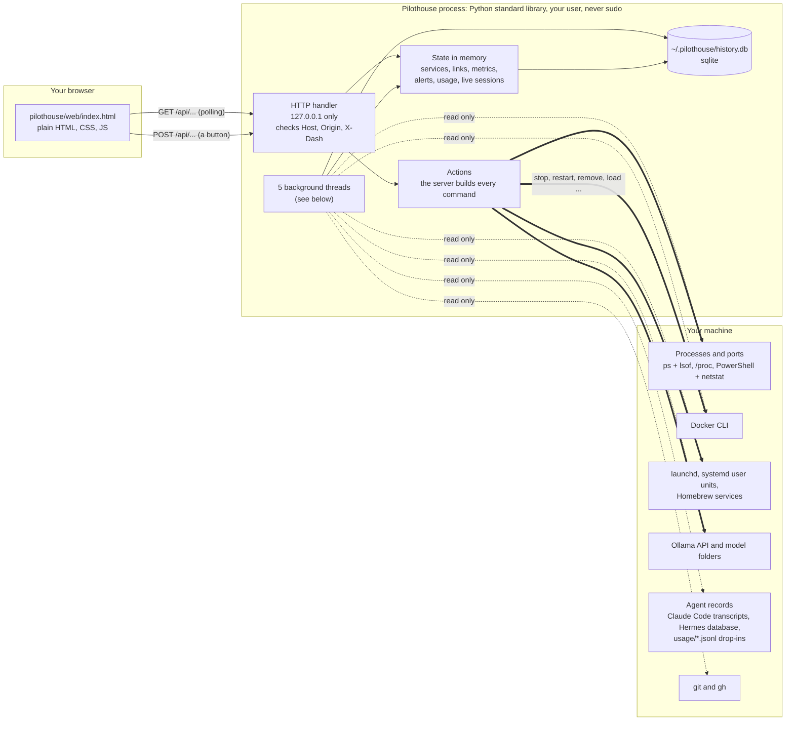
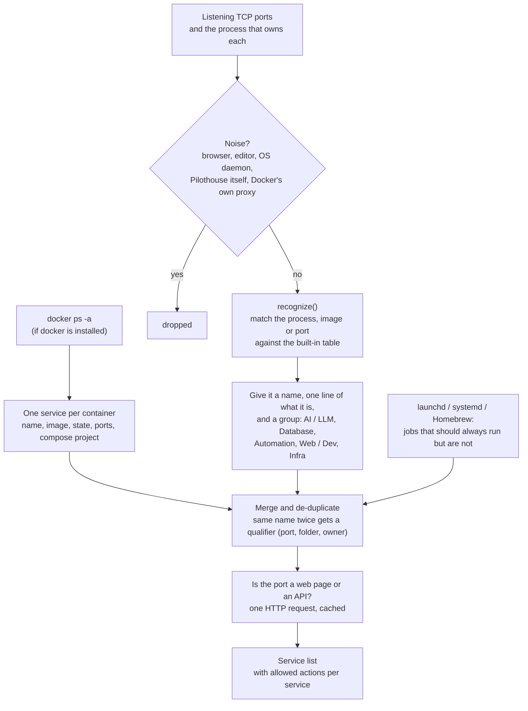
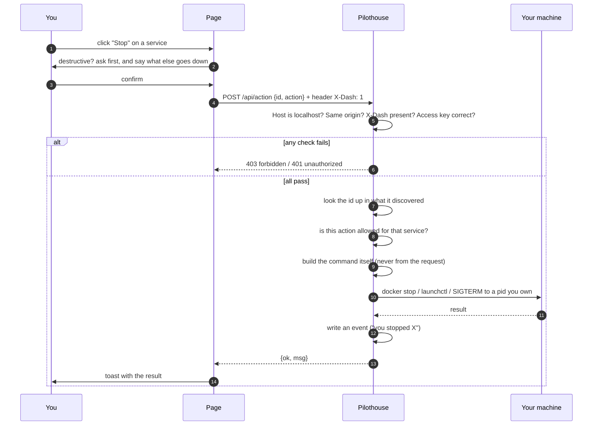
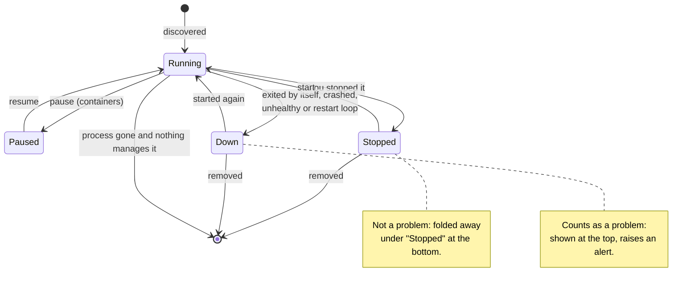
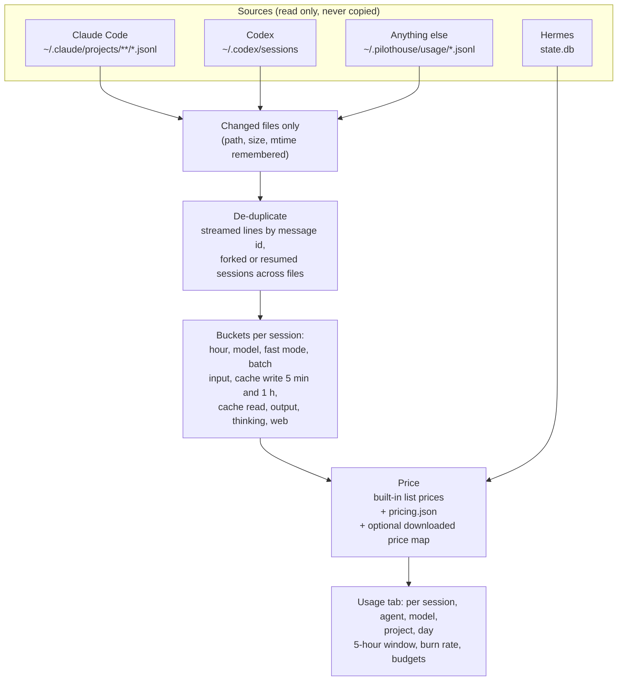

# How Pilothouse works

Pilothouse is one Python process and one HTML page. The process looks at your machine
every few seconds, keeps what it finds in memory, writes a little history to a sqlite
file, and answers the page over HTTP on `127.0.0.1`. Nothing else is involved: no
agent to install on other machines, no cloud, no database server, no build step.

- [The whole picture](#the-whole-picture)
- [Background threads](#background-threads)
- [How a service is discovered](#how-a-service-is-discovered)
- [How the map decides what talks to what](#how-the-map-decides-what-talks-to-what)
- [What happens when you press a button](#what-happens-when-you-press-a-button)
- [Service states](#service-states)
- [Usage and cost](#usage-and-cost)
- [What is stored on disk](#what-is-stored-on-disk)
- [Per operating system](#per-operating-system)
- [Where things are in the code](#where-things-are-in-the-code)

## The whole picture

Dotted arrows only read. The thick arrows are the only places Pilothouse changes
anything on your machine, and each one happens only after you press a button.

## Background threads

| Thread | Every | What it does |
|---|---|---|
| `sampler` | 2 s | CPU, memory breakdown, swap, GPU, network, disk, top processes, memory per app. Once a minute it writes one row of history. |
| `watcher` | 4 s | Rebuilds the list of services and the links between them, works out alerts, records events (up, down, appeared, vanished). |
| `model_scanner` | 15 min | Walks the model folders for `.gguf` and similar files and reads Ollama's manifests from disk. |
| `usage_scanner` | 120 s | Reads agent logs that changed since last time and adds up tokens and cost. |
| `live_scanner` | 10 s | Reads the tail of transcripts touched in the last 30 minutes to say what each session is doing. |

The page never waits for a scan. Every request is answered from what the threads
last found, so a slow `docker` or a huge model folder cannot freeze the page.

## How a service is discovered

The recognition table (`KNOWN` in `pilothouse/app.py`) is general knowledge about
software ("a process called `postgres` on 5432 is PostgreSQL"), not a list of what
happens to run on one machine. Something it has never heard of still shows up, named
after its process, with memory, CPU, logs and a stop button.

## How the map decides what talks to what

A line is drawn only when there is evidence for it. Hover a line to see which one.

| Evidence | Where it comes from |
|---|---|
| Live connection | An established TCP connection from one service's process to another's listening port. |
| Configuration | A container's environment names another container on a network they share, or `host.docker.internal:<port>` of a host service. `localhost` inside a container never counts: it points at the container itself. |
| Compose | `depends_on` in the compose project. |
| Parent and child | One service's process started the other. |

Links are remembered for 24 hours and drawn dashed when the evidence is not present
right now. Links between two containers come from their configuration, not from
sniffing traffic, so a link nobody configured by name does not appear.

## What happens when you press a button

The request can only name a thing: a service id, a pid, an app, a model. It cannot
carry a command, a path or a flag. See [SECURITY.md](../SECURITY.md) for the full list
of guards and what they do and do not protect against.

## Service states

The difference between Down and Stopped is who did it. Pilothouse remembers what you
stopped through it, and reads the restart policy and exit code for the rest.

## Usage and cost

Only numbers are kept: token counts, model ids, timestamps, the session title and its
folder. Message text is never stored. Cost is what the tokens would cost at list
price; on a subscription plan it is an estimate of value, not a bill.

## What is stored on disk

Everything lives in one folder, `~/.pilothouse` (change it with `DASH_DATA`).

| Table in `history.db` | Holds | Kept for |
|---|---|---|
| `metric` | One row a minute: CPU, memory, GPU, load, disk, network, swap | 48 hours |
| `svc` | CPU and memory per service per minute | 48 hours |
| `app` | Memory per app per minute | 48 hours |
| `event` | The timeline: up, down, appeared, vanished, alerts, your actions | 14 days |
| `edge` | Links seen between services | 24 hours |
| `kv` | Small settings: budgets, which alerts are already known | until changed |
| `usage_file` | Per log file: size, modified time and its token totals | while the log exists |
| `usage_msg` | A hash per counted message, so nothing is counted twice | while the log exists |

Other files in the folder: `token` (the access key, readable only by you),
`usage/*.jsonl` (your own drop-in usage records),
`agents.json` and `pricing.json` (your own additions), and a small launcher script
written the first time you start an agent from the page. Delete the folder and
Pilothouse starts from nothing; it does not touch anything outside it.

## Per operating system

| What | macOS | Linux | Windows |
|---|---|---|---|
| Processes | `ps` | `/proc/<pid>/stat`, `status`, `cmdline` | PowerShell `Get-CimInstance Win32_Process` |
| Listening ports | `lsof` | `/proc/net/tcp*` matched to `/proc/<pid>/fd` | `netstat -ano` |
| Memory per process | footprint from `proc_pid_rusage` (resident + compressed + swapped) | resident + swap from `/proc` | working set |
| CPU | `host_statistics` ticks | `/proc/stat` | `GetSystemTimes` |
| Memory | `vm_stat` | `/proc/meminfo` | `GlobalMemoryStatusEx` |
| GPU | `ioreg` | `nvidia-smi` if present | not read |
| Service manager | launchd, Homebrew | systemd user units | none yet |
| Stop a process | `SIGTERM`, then `SIGKILL` on request | same | `taskkill` |

Every probe is allowed to fail. A missing tool gives an empty section, never a crash.

## Where things are in the code

`pilothouse/app.py` is one long file on purpose: it runs from a clone with nothing to
install and can be read top to bottom. Its sections, in order:

| Section | Main functions |
|---|---|
| Platform probes | `snapshot`, `linux_procs`, `parse_win_procs`, `listening`, `linux_sockets`, `parse_netstat`, `footprint` |
| Docker and service managers | `docker_ps`, `brew_services`, `launch_agents`, `systemd_unit` |
| Recognition | `KNOWN`, `recognize`, `ROLE`, `web_kind`, `discover_services` |
| Links | `established`, `docker_details`, `discover_edges` |
| State, history, alerts | `db_open`, `event`, `history`, `since`, `compute_alerts`, `refresh`, `watcher` |
| Host metrics | `cpu_stat`, `mem_stat`, `gpu_util`, `net_rates`, `top_apps`, `sampler` |
| Inventory | `AGENT_DEFS`, `inv_agents`, `inv_models`, `inv_repos`, `inv_docker` |
| Usage and cost | `PRICES`, `scan_claude_file`, `scan_codex_file`, `scan_generic_file`, `usage_scanner`, `usage_report`, `usage_blocks`, `live_scanner` |
| Actions | `do_action`, `group_action`, `proc_action`, `app_action`, `model_action`, `docker_action`, `agent_action`, `open_path` |
| HTTP | `POSTS`, class `H`, `main` |
| Self-test | `selftest` (run with `python3 server.py --selftest`) |

`pilothouse/demo.py` produces the made-up data for `--demo`. In demo mode no probe thread starts and no database is opened.
`pilothouse/web/index.html` is the whole front end; it has no build step.
