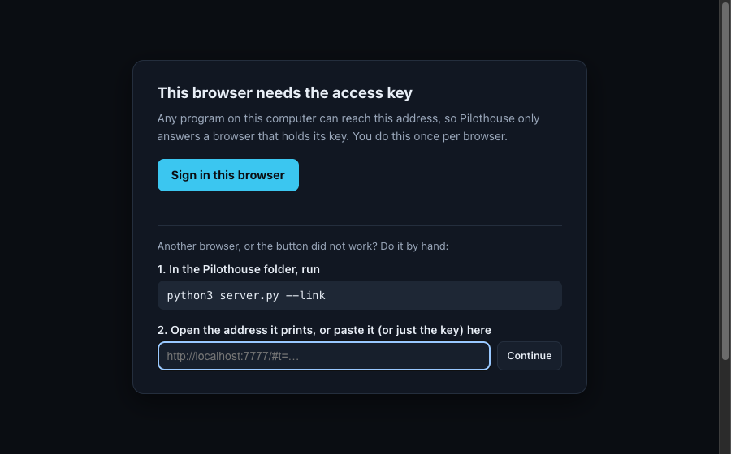

# Install and run

You need **Python 3.8 or newer**. Nothing else. There is nothing to `pip install`.

## 1. Get it

```bash
git clone https://github.com/hamzakoc/pilothouse.git
```

```bash
cd pilothouse
```

(No git? Download the ZIP from the repository page and unpack it.)

## 2. Start it

| System | Do this |
|---|---|
| macOS | `python3 server.py --open`, or double-click `start.command` |
| Linux | `python3 server.py --open`, or run `./start.sh` |
| Windows | `py server.py --open`, or double-click `start.bat` |

`--open` opens the page for you, already signed in. That is all.

A browser that has never seen Pilothouse asks for the access key once. Press **Sign in
this browser** on that screen. If that browser is not your default one, run
`python3 server.py --link` and paste the address it prints. Why there is a key:
[SECURITY.md](../SECURITY.md#3-other-users-and-programs-on-the-computer-need-the-key).



Then take the [tour](TOUR.md).

Want to look before it reads your machine? Start it with made-up data:

```bash
python3 server.py --demo --open
```

## 3. Check what it can see

```bash
python3 server.py --doctor
```

It prints which tools it found and what each missing one would add. Nothing is
required; each tool only adds a section:

| If you have | You also get |
|---|---|
| Docker (Docker Desktop, colima, OrbStack, Podman with the docker CLI) | Containers, images, volumes, compose stacks, links between containers |
| Ollama | Models in memory, load and unload, model details |
| git | The Repos tab |
| GitHub CLI (`gh`) | Your signed-in accounts next to the repos |
| An AI coding agent (Claude Code, Codex, Hermes, ...) | The Agents tab, usage and cost, live sessions |

## Python is missing?

- **macOS**: `xcode-select --install` brings Python 3, or install it from python.org
  or with Homebrew (`brew install python`).
- **Linux**: it is almost always there. If not: `sudo apt install python3` or your
  distribution's equivalent.
- **Windows**: install it from https://www.python.org/downloads/ and tick "Add
  python.exe to PATH".

## Keep it running

Pilothouse only records history while it runs. To have last night's events in the
morning, start it at login. Ready-made files are in [`examples/`](../examples).

A login item starts Pilothouse without a terminal, so it cannot hand the key to your
browser by itself. Open `http://localhost:7777` once, press **Sign in this browser**,
and bookmark the page.

### macOS (launchd)

1. Copy `examples/launchd/com.pilothouse.plist` to `~/Library/LaunchAgents/`.
2. Edit the paths in it: your `python3` (find it with `which python3`), the folder
   you cloned into, and your user name in the log path.
3. Load it:

```bash
launchctl bootstrap gui/$(id -u) ~/Library/LaunchAgents/com.pilothouse.plist
```

To stop it for good: `launchctl bootout gui/$(id -u)/com.pilothouse`.

### Linux (systemd, your user, no root)

1. Copy `examples/systemd/pilothouse.service` to `~/.config/systemd/user/`.
2. Edit the path in `ExecStart`.
3. Enable it:

```bash
systemctl --user enable --now pilothouse
```

To keep it running while you are logged out: `loginctl enable-linger $USER`.

### Windows (Task Scheduler)

Run the command in `examples/windows/install-task.cmd` (edit the path first). It
creates a task that starts Pilothouse when you log in, without a console window.

## Install as a command (optional)

```bash
pip install .
```

gives you a `pilothouse` command that works from any folder. This is a convenience
only: it installs no dependencies.

## Update

```bash
git pull
```

then restart it. Your history and your own `agents.json` / `pricing.json` are kept.

## Remove

Stop it, remove the login item if you made one, delete the clone, and delete the data
folder `~/.pilothouse`. Pilothouse writes nowhere else.
