# A tour of Pilothouse

Ten minutes, top to bottom. Every picture here shows the built-in sample data, so you
can follow along without touching your own machine:

```bash
python3 server.py --demo --open
```

When you are ready for the real thing, leave `--demo` out. Nothing else changes.

- [First start](#first-start)
- [Overview: is anything wrong?](#overview-is-anything-wrong)
- [Services: what runs, and what talks to what](#services-what-runs-and-what-talks-to-what)
- [One service in detail](#one-service-in-detail)
- [Agents: your AI tools](#agents-your-ai-tools)
- [Models: what is downloaded, what is in memory](#models-what-is-downloaded-what-is-in-memory)
- [Usage: tokens and cost](#usage-tokens-and-cost)
- [Docker](#docker)
- [Repos](#repos)
- [Activity: what happened, and the alert rules](#activity-what-happened-and-the-alert-rules)
- [Keys and habits worth knowing](#keys-and-habits-worth-knowing)

## First start

```bash
python3 server.py --open
```

The page opens signed in. If you later open `http://localhost:7777` in a browser that
has never seen Pilothouse, you get this instead:

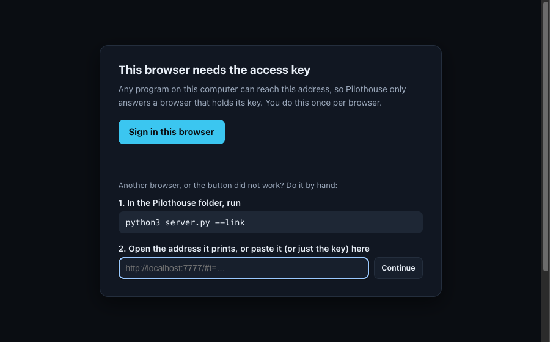

Press **Sign in this browser**. Pilothouse opens the signed-in page in your default
browser and this tab unlocks by itself. For a browser that is not your default, run
`python3 server.py --link` and paste what it prints. You do this once per browser.
Why a key at all: [SECURITY.md](../SECURITY.md#3-other-users-and-programs-on-the-computer-need-the-key).

## Overview: is anything wrong?

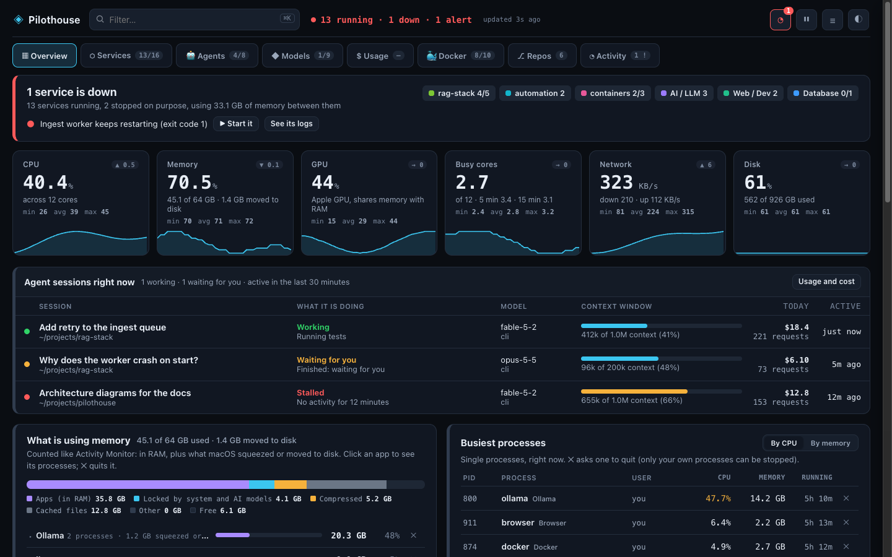

Read it from the top:

1. **The banner** says in one sentence whether something needs you. If a service is
   down, the buttons to start it or read its logs are right there.
2. **The six tiles** are CPU, memory, GPU, busy cores, network and disk, each with
   its last minutes as a small chart.
3. **Agent sessions right now** lists every AI session active in the last 30
   minutes: working, waiting for you, or stalled, and how full its context is.
4. **What is using memory** is the Activity Monitor view, app by app. Click an app
   to see its processes. The ✕ asks it to quit.
5. Further down: history charts (Live, 1h, 6h, 24h, 48h), models in memory, recent
   events and a table of running containers.

It also comes in light. The half-moon button at the top right switches.

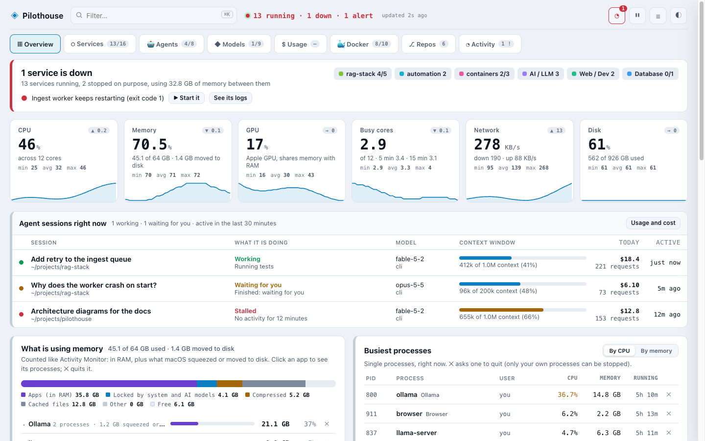

## Services: what runs, and what talks to what

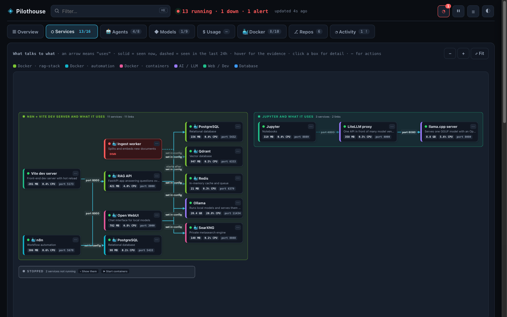

Every Docker container and every program listening on a port is a box: name, one
line of what it is, memory, CPU, port. A line between two boxes means one uses the
other, and it is only drawn when there is evidence. Hover a line to see which:
a live connection, a setting that names the other service, or compose `depends_on`.

- Each connected set of services is its own colored section.
- Things you stopped fold away under **Stopped** at the bottom. They are not gone.
- The `…` on a box opens its actions: restart, stop, pause, logs, remove.
- Below the map the same services are a list, grouped, with a memory trend per row.
  **Show** narrows it to running, stopped or problems; **Sort** orders by memory or CPU.

## One service in detail

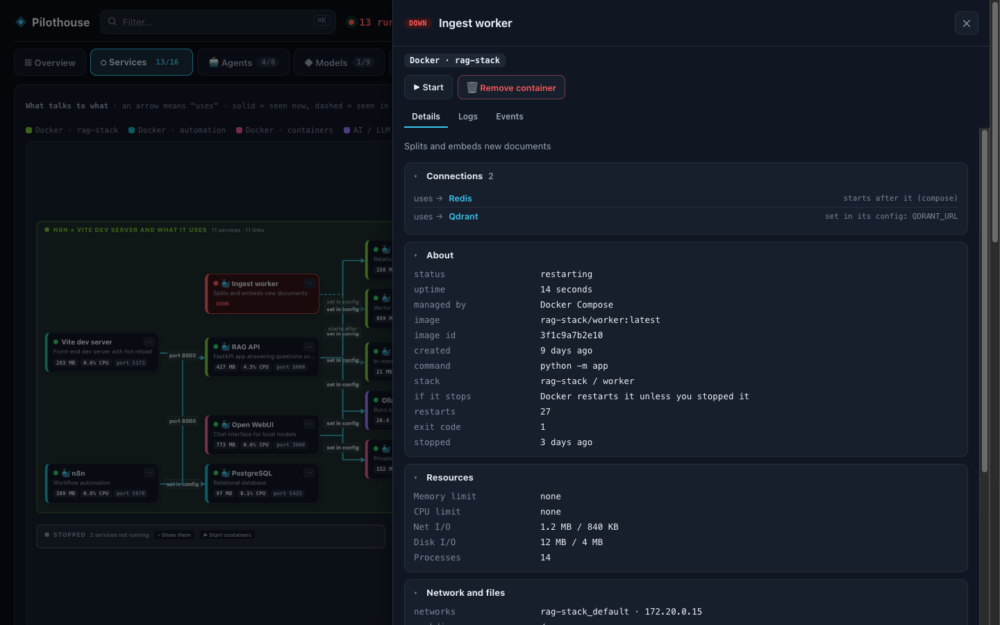

Click any service, anywhere in the app. The panel answers, in order: what is it
connected to, what state is it in and who manages it, what does it use, where are its
files and ports, and what did it log. The **Logs** tab filters and follows; the
**Events** tab is that one service's history.

For a container that keeps restarting, look at `restarts`, `exit code` and the last
log lines first. That is usually the whole story.

## Agents: your AI tools

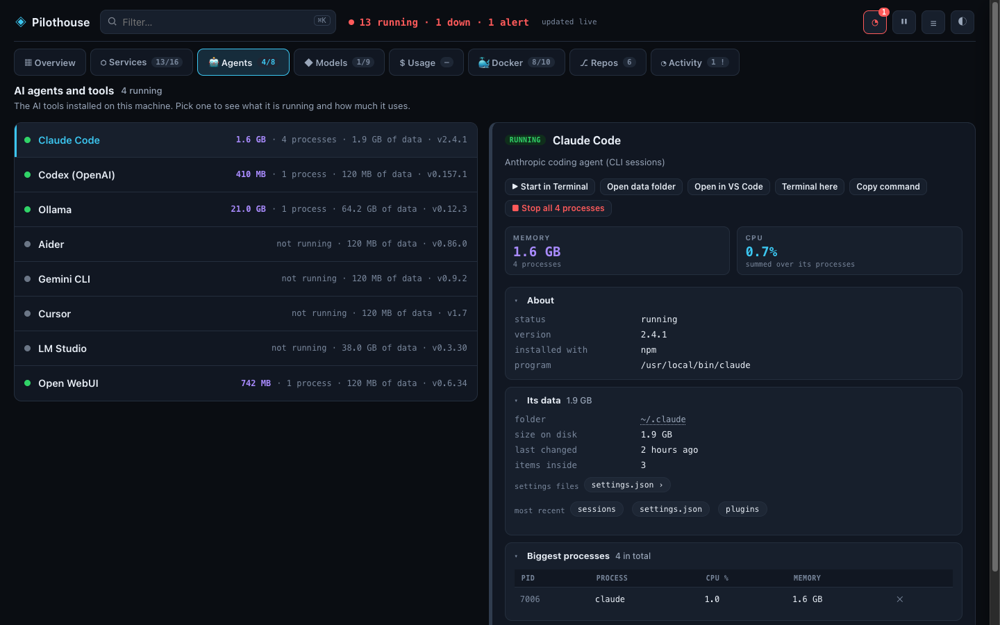

All AI tools Pilothouse finds on the machine: coding agents, desktop apps and local
runtimes. Pick one on the left; the right side shows whether it runs, its version and
how it was installed, how much memory its processes use, and where its data and
settings live. From here you can start it in a terminal, open its folder, or stop all
its processes.

A tool that is missing can be taught in four lines:
[CONFIGURATION.md](CONFIGURATION.md#agentsjson-teach-it-an-ai-tool-it-does-not-know).

## Models: what is downloaded, what is in memory

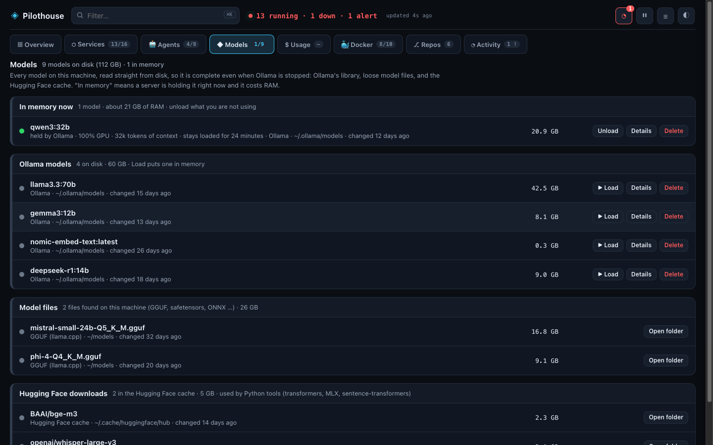

Models are read from disk, so the list is complete even while Ollama is stopped:
Ollama's library, loose `.gguf` files and the Hugging Face cache. **In memory now**
at the top is what costs you RAM this minute. Unload what you are not using, load
what you need next, delete what you never use. Deleting asks first.

## Usage: tokens and cost

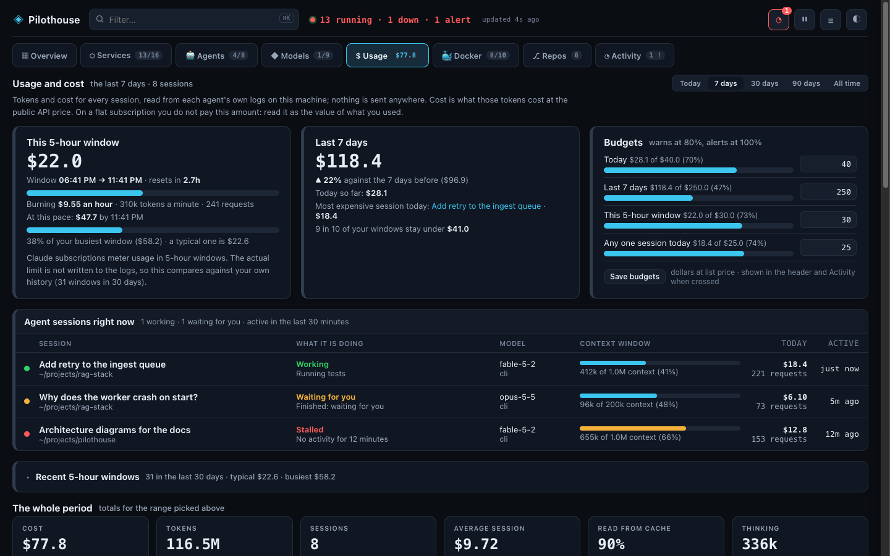

Read from each agent's own records, never from the network.

- **Right now**: the open 5-hour window, how fast you are spending, and where it
  will end if you keep going.
- **Budgets**: set an amount per day, per week, per window or per session. 80% warns,
  100% alerts.
- **Breakdowns**: per session, agent, model, project folder and day. Click a session
  for its models, hours and sub-agents.

Cost is tokens at public list price. On a subscription it is the value of what you
used, not your bill. Tools Pilothouse cannot read can report their own usage with one
line per request:
[CONFIGURATION.md](CONFIGURATION.md#usagenamejsonl-usage-of-a-tool-pilothouse-cannot-read).

## Docker

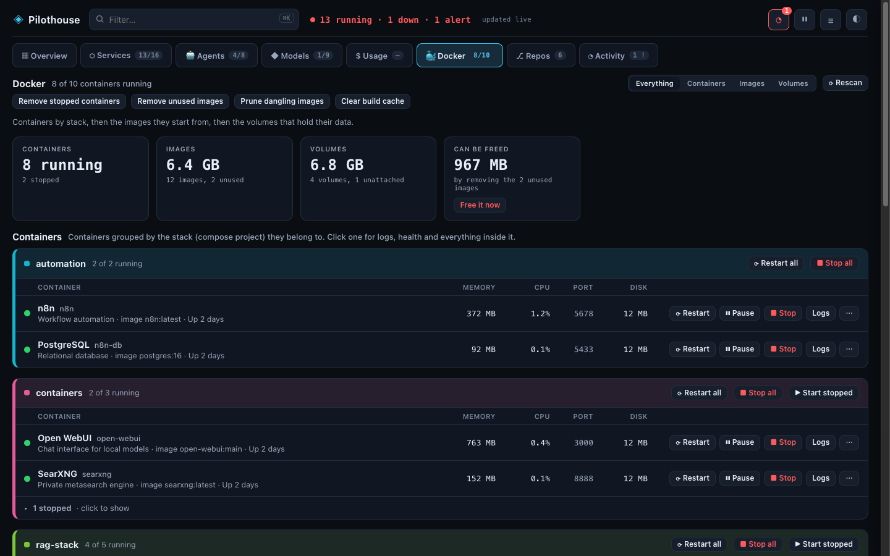

Containers grouped by compose project, with the images they start from and the
volumes that hold their data. The tiles at the top say how much disk can be freed
safely. Whole-stack buttons (**Restart all**, **Stop all**) sit on each group.
If the engine behind Docker is not running, the tab says which one and offers to start
it. Clean-up never touches volumes in bulk; a single volume can only be removed when
Docker reports it unused.

## Repos

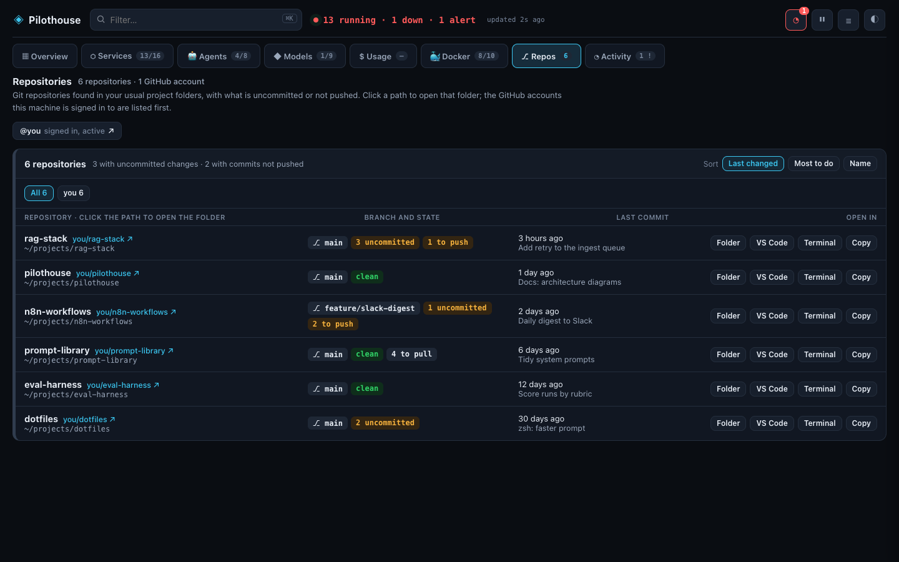

Git repositories in your usual project folders: branch, uncommitted changes, commits
to push or pull, last commit. Click the path to open the folder, or use the buttons
for your editor and a terminal. Folders somewhere unusual: start with
`DASH_REPOS=/path/one:/path/two`.

## Activity: what happened, and the alert rules

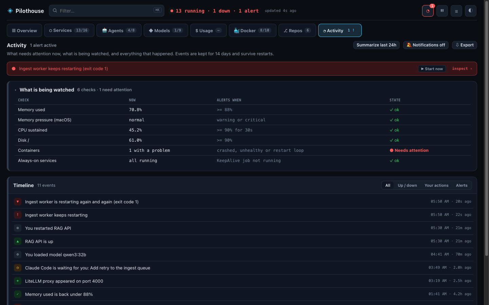

**What is being watched** lists every check with its current value and the limit that
raises an alert. The **Timeline** below is everything that went up or down, every
alert, and every button you pressed, kept for 14 days. **Summarize last 24h** gives
you the morning read; **Export** saves the timeline.

History is only recorded while Pilothouse runs. To have the night covered, start it
at login: [INSTALL.md](INSTALL.md#keep-it-running).

## Keys and habits worth knowing

| Key | Does |
|---|---|
| `1` to `8` | Jump to a tab |
| `⌘K` or `Ctrl K` | Command palette: find any service, agent, model or action |
| `/` | Filter what is on screen |
| `Esc` | Close the detail panel |

- The pause button at the top (or the space bar) freezes the numbers while you read.
- The bell shows alerts wherever you are.
- Anything destructive asks first and says what else will go down with it.
- Stuck or something missing? `python3 server.py --doctor`, then
  [TROUBLESHOOTING.md](TROUBLESHOOTING.md).
